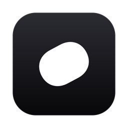
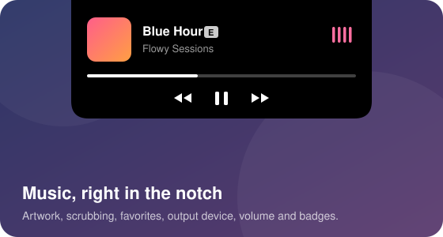
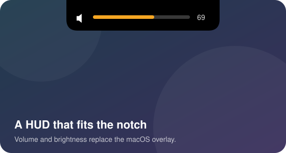
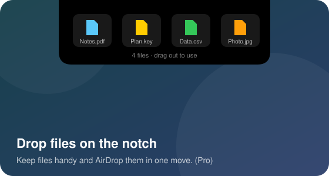
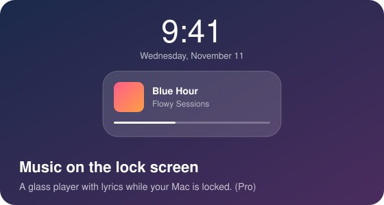
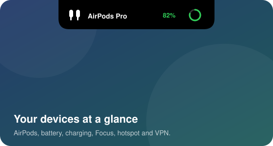
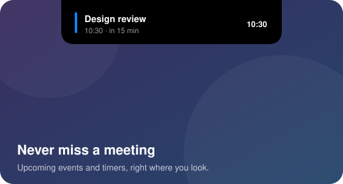

<div align="center">



<picture>
  <source media="(prefers-color-scheme: dark)" srcset="assets/github/hero-dark.svg">
  
</picture>

**Music, a smarter HUD, a file tray and your devices — living in the notch.**

[](https://github.com/OWNER/flowy/releases/latest)
&nbsp;
[](https://flowdy.lemonsqueezy.com/checkout/buy/dafdf3bb-75cb-46fd-9f70-fbd451c7194f)


</div>

---

## Features

<table>
  <tr>
    <td width="50%"></td>
    <td width="50%"></td>
  </tr>
  <tr>
    <td></td>
    <td></td>
  </tr>
  <tr>
    <td></td>
    <td></td>
  </tr>
</table>

- **Music** — artwork, scrubbing, favorites, output device, volume, and an Explicit or Lossless badge. Works with Apple Music, Spotify and most players.
- **HUD** — volume and brightness appear in the notch instead of the macOS overlay.
- **File Tray** — drop files on the notch, keep them there, AirDrop them in one move.
- **Devices & status** — AirPods and accessory battery, charging, low power, Focus, hotspot, VPN and downloads.
- **Calendar & timers** — upcoming events and a quick timer, where you already look.
- **Lock screen** — a glass music player with lyrics while your Mac is locked.
- **Asks politely** — every permission is explained with a preview before macOS asks.

## Free and Pro

|                                   | Free | Pro |
| --------------------------------- | :--: | :-: |
| Music, HUD, devices, calendar, timers | ✓ | ✓ |
| Updates                           | ✓ | ✓ |
| File Tray & AirDrop from the notch |   | ✓ |
| Music on the lock screen           |   | ✓ |

**Pro is a one-time €6.99 purchase** — no subscription, never expires, includes every future update, and works on **2 Macs**. Try it free for 14 days from **Settings › License**.

<div align="center">

[**Get Flowy Pro →**](https://flowdy.lemonsqueezy.com/checkout/buy/dafdf3bb-75cb-46fd-9f70-fbd451c7194f)

</div>

## Install

1. Download **`Flowy-<version>.dmg`** from [Releases](https://github.com/OWNER/flowy/releases/latest).
2. Drag **Flowy** to **Applications** and open it.
3. The first time, macOS asks you to confirm an app from the internet: open **System Settings › Privacy & Security** and click **Open Anyway**. You only do this once — updates install themselves.

Full guide, permissions and checksums: [docs/INSTALL.md](docs/INSTALL.md).

Requires **macOS 26 or later**, on Apple Silicon or Intel.

## Privacy

Flowy runs on your Mac. It doesn't have accounts, ads or analytics.
The only things that leave your Mac are: the license check with Lemon Squeezy (Pro only), update checks, lyrics lookups, and — if you turn on the Explicit badge — the song title and artist sent to Apple's public music catalog.

## FAQ

<details>
<summary><b>Why does macOS warn me the first time?</b></summary>

Flowy is an independent app that isn't notarized by Apple yet. macOS asks you to confirm it once; after that it opens normally and updates install without the warning.
</details>

<details>
<summary><b>Can I move Pro to a new Mac?</b></summary>

Yes. In **Settings › License**, click **Deactivate this Mac**, then enter your key on the new one. Each key works on 2 Macs at a time.
</details>

<details>
<summary><b>Does Pro work offline?</b></summary>

Yes. Flowy checks your key about once a week and keeps Pro working for 30 days without a connection.
</details>

<details>
<summary><b>Which permissions does Flowy need?</b></summary>

Only the ones for the features you turn on: Accessibility for the HUD, Bluetooth for accessory battery, Calendar for events, Camera for the mirror. Each one is explained before macOS asks.
</details>

## Build from source

```bash
git clone https://github.com/OWNER/flowy.git
cd flowy
open NotchFlow.xcodeproj   # scheme: NotchFlow
```

Release builds: `scripts/release-dmg.sh`. Developer notes: [docs/DEVELOPMENT.md](docs/DEVELOPMENT.md).

## License & credits

Flowy is free software under the **[GNU GPL v3](LICENSE)** and comes with no warranty.
It builds on [DynamicNotch](https://github.com/jackson-storm/dynamicnotch) — its authors keep their copyright — and uses
[Sparkle](https://sparkle-project.org), [Lottie](https://github.com/airbnb/lottie-ios) and
[MediaRemoteAdapter](https://github.com/ungive/mediaremote-adapter). See [THIRD_PARTY_NOTICES](THIRD_PARTY_NOTICES/).
